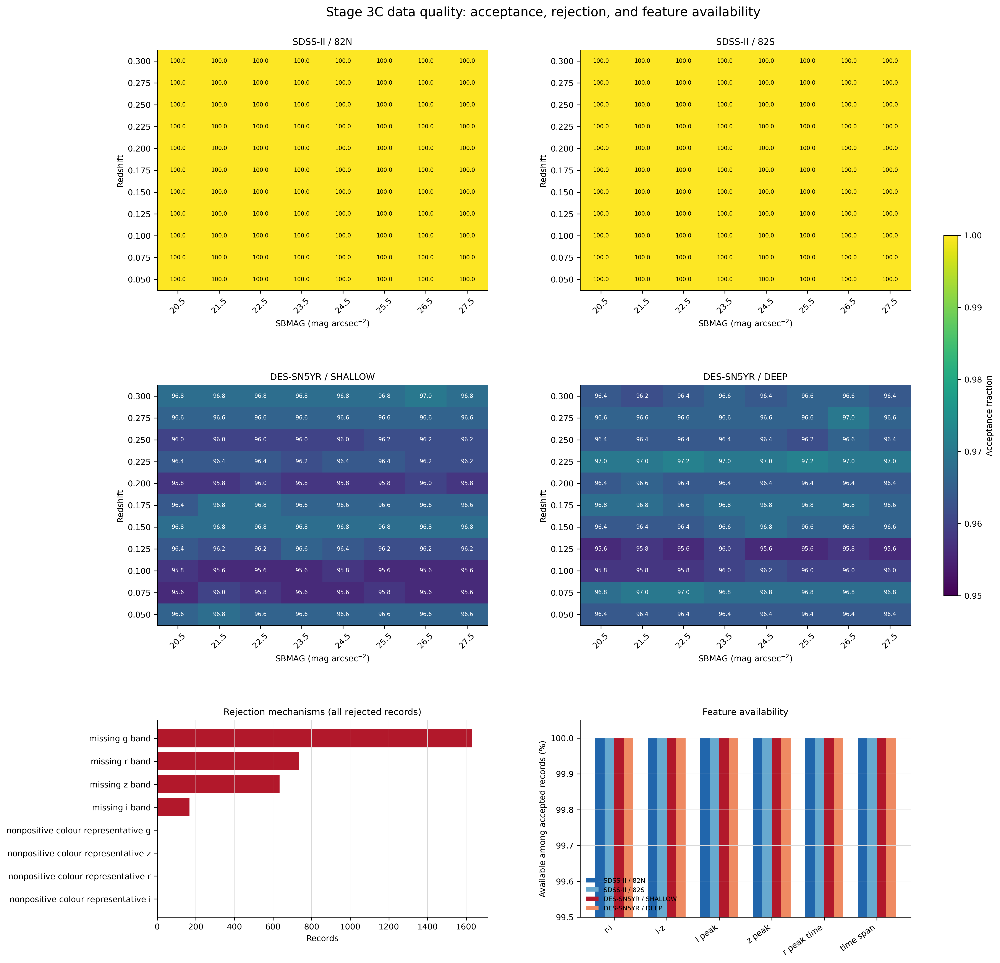
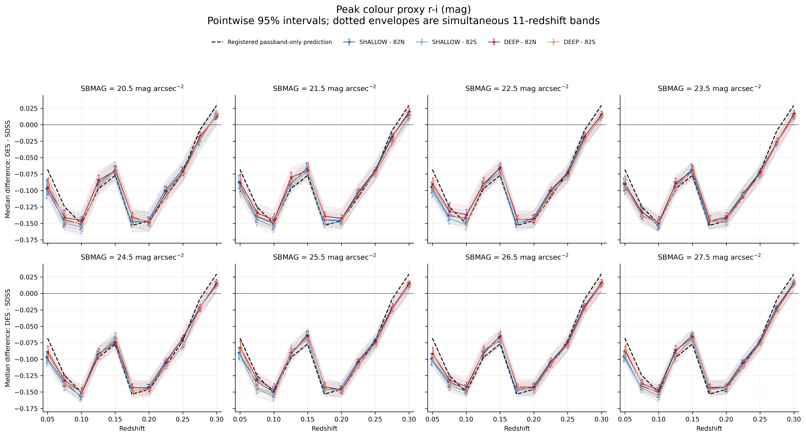
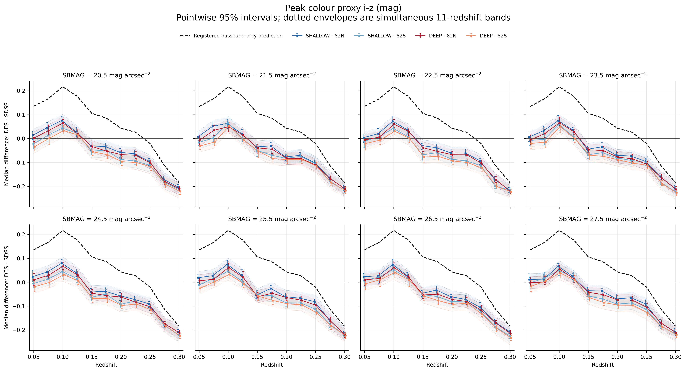
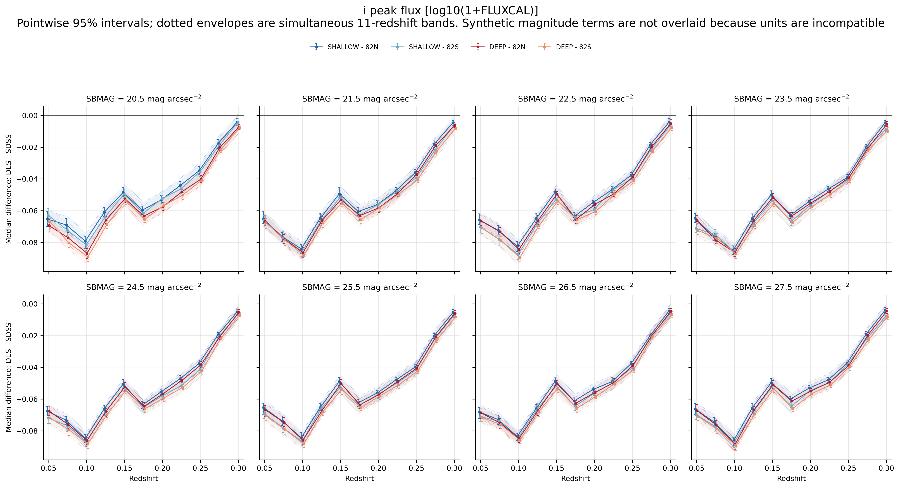
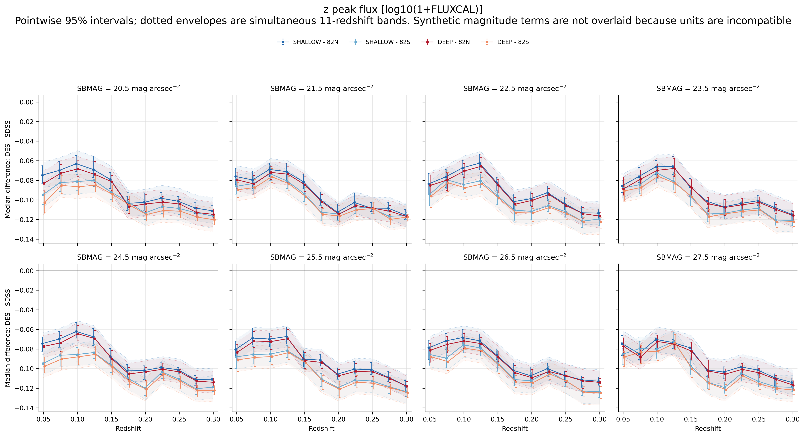
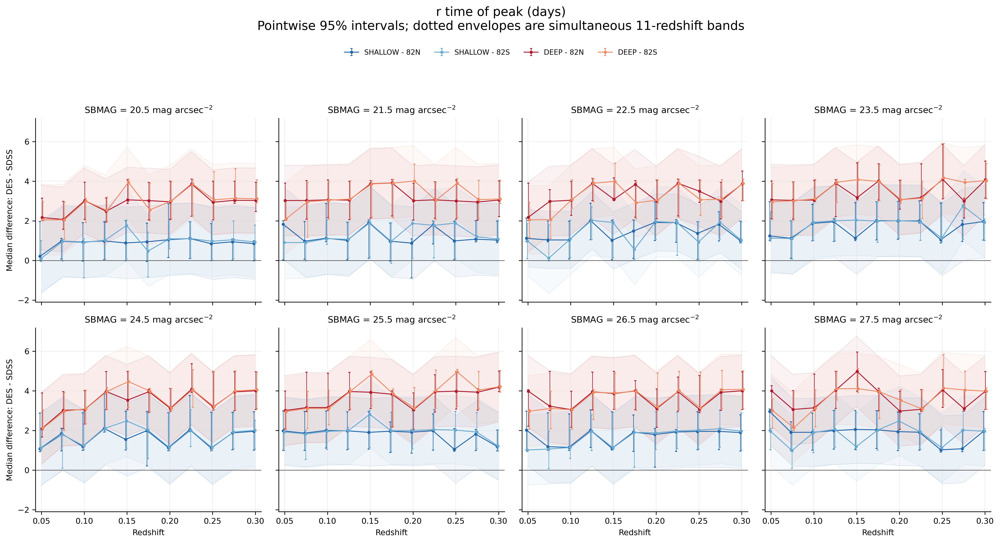
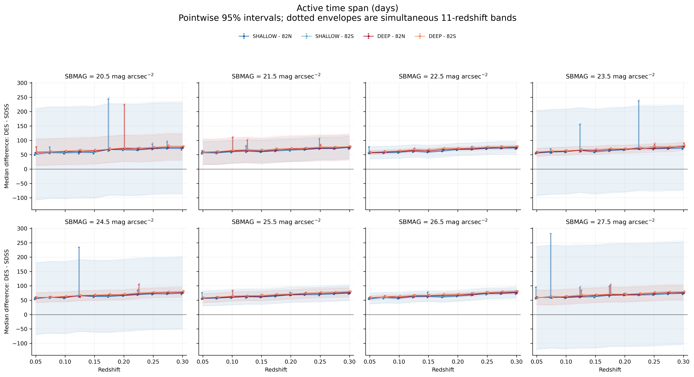
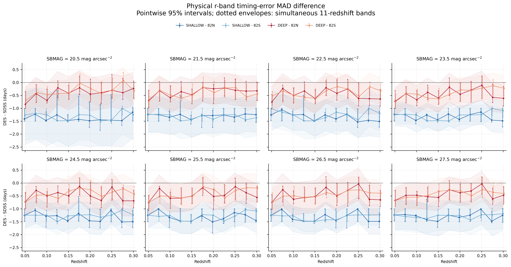
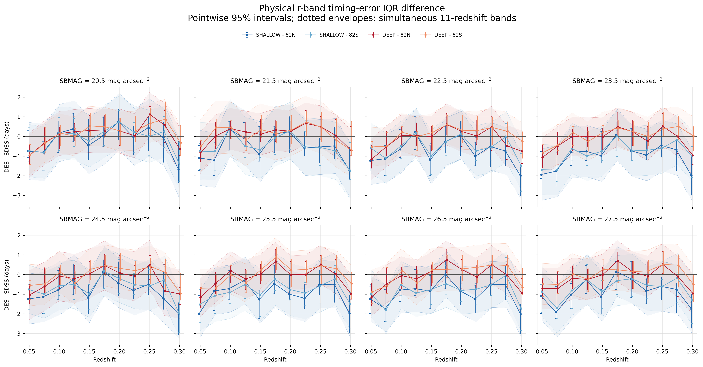

# Stage 3C Scientific Assessment

**Assessment date:** 2026-10-12

**Experiment:** fixed-Hsiao survey-operator Monte Carlo for SDSS-II and DES-SN5YR

**Analysis output:** `phase3_real_survey/results/stage3c_step5_statistical_analysis/stage3c_step5_analysis.json`

**Analysis SHA-256:** `ea2a709250782f03e82806eae8c520fb2186bc44387d2b7a16b9f96070423094`

## Executive Summary

Stage 3C establishes that the frozen SDSS-II and DES-SN5YR observing operators
produce large, precisely measured differences in several compact features for a
single fixed Hsiao SN Ia source model. The evidence is mixed relative to the
frozen physical predictions.

- `peak_color_r_minus_i` is **SUPPORTED directionally**: DES-SDSS is negative
  at every registered stratum through `z=0.275` and positive at `z=0.300`.
  The detailed synthetic magnitude is not recovered uniformly.
- `i_peak_flux` is **SUPPORTED qualitatively**: DES-SDSS is negative through
  the full grid and approaches equality at `z=0.300`, but it does not reverse.
  A numerical passband residual is not valid because the registered synthetic
  prediction and extracted feature use different transformations.
- `peak_color_i_minus_z` is **CONTRADICTED as preregistered**: the measured
  reversal occurs between approximately `z=0.125` and `0.150`, not between
  `z=0.225` and `0.250`.
- `z_peak_flux` is **CONTRADICTED as preregistered**: DES-SDSS is negative in
  all 352 cells, including the low-redshift region where a positive passband-only
  difference was predicted.
- The broader-DES physical timing-error prediction is **CONTRADICTED** by its
  primary statistic. `MAD_DES(e_r)-MAD_SDSS(e_r)` is never significantly
  positive and is robustly negative for both shallow comparisons.
- `time_span`, a supportive and partially informed feature, is longer for DES
  in all cells. The deep-field prediction is supported by all simultaneous
  bands; the shallow simultaneous bands include zero in half of their cells.

These results support the narrower statement that documented survey operators
can generate coherent compact-feature shifts. They do **not** yet support the
stronger proposition that the preregistered passband and cadence mechanisms
explain those shifts consistently across independent feature families. No
normalization was applied, and this experiment does not test real-supernova
class structure or classification performance.

## 1. Scope and Frozen Design

The assessment was performed only after reading the frozen physics
preregistration, Stage 3C forward-operator specification, statistical
clarification and freeze, output schema, analysis manifest, and the completed
analysis JSON. The Monte Carlo and bootstrap were not rerun.

The complete design contains:

- four survey branches: SDSS-II `82N`, SDSS-II `82S`, DES-SN5YR `SHALLOW`, and
  DES-SN5YR `DEEP`;
- 11 redshifts from `0.050` to `0.300` in increments of `0.025`;
- eight `SBMAG` values from `20.5` to `27.5`;
- 500 realization identifiers per branch, redshift, and `SBMAG` cell;
- 176,000 records in total;
- four separately retained DES-minus-SDSS comparisons; and
- 5,000 paired deterministic bootstrap replicates.

The location estimator is the difference of accepted marginal medians,
`median(DES)-median(SDSS)`, not the median of paired differences. Pointwise
intervals are 95% percentile intervals. Simultaneous bands use the frozen
maximum-absolute-deviation construction across all 11 redshifts for one feature,
`SBMAG`, and comparison. No registered stratum is pooled or omitted here.

The simulation uses one fixed SN Ia spectral-time model. It isolates effects of
the encoded survey operators; it cannot establish behavior for the diversity of
real SNe Ia, ordinary core-collapse SNe, or a classification boundary.

## 2. Data Integrity

The analysis hash agrees with its manifest. Grid validation reports the expected
176,000 records, exact branches and grids, 500 realization identifiers per cell,
and no missing cells, duplicates, missing identifiers, or unexpected identifiers.
The analysis reports no undefined bootstrap statistics or simultaneous-band
failures.

| Survey branch | Total | Accepted | Rejected | Cell acceptance range |
|---|---:|---:|---:|---:|
| SDSS-II / 82N | 44,000 | 44,000 | 0 | 100.0%-100.0% |
| SDSS-II / 82S | 44,000 | 44,000 | 0 | 100.0%-100.0% |
| DES-SN5YR / SHALLOW | 44,000 | 42,375 | 1,625 | 95.6%-97.0% |
| DES-SN5YR / DEEP | 44,000 | 42,447 | 1,553 | 95.6%-97.2% |



### Rejection mechanisms

All 3,178 rejected realizations occur in DES branches. The frozen extractor
reports:

| Rejection mechanism | Count | Fraction of rejections |
|---|---:|---:|
| Missing usable g band | 1,630 | 51.29% |
| Missing usable r band | 735 | 23.13% |
| Missing usable z band | 634 | 19.95% |
| Missing usable i band | 167 | 5.25% |
| Nonpositive colour representative, any band | 12 | 0.38% |

Every analyzed feature is finite for every accepted realization in every cell.
Thus, feature-specific missingness does not further differentiate the analyzed
samples; missingness enters through whole-record rejection under the four-band
support rule.

### Selection implications

The DES estimands describe accepted DES realizations, whereas the SDSS estimands
describe the complete simulated SDSS populations. This asymmetric acceptance is
small in fraction but mechanistically relevant because rejection is dominated by
band availability and therefore can depend on cadence, depth, redshift, phase,
and host surface brightness. The paired bootstrap preserves all 500 realization
identifiers and handles rejection through masks, but it cannot remove this
selection effect. A measured DES-SDSS difference is consequently the combined
effect of the survey operator, the frozen extractor, and its induced accepted
population.

## 3. Hypothesis Assessment Matrix

| Registered outcome | Frozen prediction | Evidence | Assessment |
|---|---|---|---|
| `peak_color_r_minus_i` | Negative through `z=0.275`; positive near `z=0.300` | All 320 lower-redshift cells are pointwise negative; all 32 `z=0.300` cells are pointwise positive. Simultaneous bands are negative in all 320 lower-redshift cells and positive in 26/32 boundary cells. | **SUPPORTED directionally** |
| `peak_color_i_minus_z` | Positive through `z=0.225`; negative from `z=0.250` | Positive at `z=0.100`, mixed near the low-z boundary, but uniformly negative from `z=0.150` onward. | **CONTRADICTED** |
| `i_peak_flux` | DES lower through `z=0.275`; near equality or sign change at `z=0.300` | Negative in all 352 pointwise intervals; simultaneous bands negative in 349/352 cells. Magnitude shrinks strongly by `z=0.300` but does not reverse. | **SUPPORTED qualitatively** |
| `z_peak_flux` | DES higher at low z, lower at high z | Negative in every cell, with every pointwise and simultaneous interval below zero. | **CONTRADICTED** |
| Physical `r` timing dispersion | DES peak-recovery errors broader than SDSS | Primary MAD difference is never significantly positive and is robustly negative for shallow comparisons. | **CONTRADICTED** |
| Raw `r_time_of_peak` median | No marginal median sign registered | Mostly or wholly positive, but this does not test the registered dispersion prediction. | **INCONCLUSIVE by design** |
| `time_span` (supportive) | DES deep longer than SDSS; no unconditional shallow sign | Positive in all pointwise intervals; deep simultaneous bands all positive, shallow bands split between positive and zero-containing. | **SUPPORTED for deep; supportive only** |

## 4. Primary Feature Findings

The companion [summary tables](stage3c_summary_tables.md) retain estimator ranges,
quantile ranges, Wasserstein-1 ranges, and pointwise/simultaneous sign counts for
each of the four comparisons. The figures show all eight `SBMAG` strata without
pooling.

### 4.1 `peak_color_r_minus_i`



The DES-minus-SDSS median difference is negative at all 32 comparison-by-`SBMAG`
coordinates at each redshift from `0.050` through `0.275`, then positive at all
32 coordinates at `z=0.300`. Its cross-stratum envelope evolves from
`[-0.1021,-0.0830]` mag at `z=0.050`, reaches approximately
`[-0.1562,-0.1369]` mag at `z=0.100`, and becomes `[0.0095,0.0204]` mag at
`z=0.300`.

All lower-redshift pointwise and simultaneous intervals exclude zero in the
negative direction. At `z=0.300`, all pointwise intervals are positive; 26 of
32 simultaneous intervals are positive and six include zero. Quantile shifts
and W1 distances show that the result is not solely a median displacement: W1
ranges from `0.0172` to `0.1837` mag across comparisons and strata.

This is strong directional and redshift-structural agreement with the frozen
prediction. It is not exact quantitative validation: the registered synthetic
value lies inside the simultaneous band unevenly across redshift, including only
3/32 cells at `z=0.300`. Cadence, depth, asynchronous top-three flux selection,
and whole-record acceptance remain active in the extracted feature.

### 4.2 `peak_color_i_minus_z`



The measured curve is mixed at `z=0.050`, becomes significantly positive in all
32 cells at `z=0.100`, is mixed at `z=0.125`, and is significantly negative in
all cells from `z=0.150` through `0.300`. The median envelope is
`[0.0303,0.0795]` mag at `z=0.100`, `[-0.0772,-0.0293]` mag at `z=0.150`, and
`[-0.2334,-0.2027]` mag at `z=0.300`.

The registered passband-only prediction remained positive through `z=0.225` and
reversed only at `z>=0.250`. The observed early reversal therefore contradicts
the predeclared redshift function, even though the high-redshift negative sign is
consistent. The disagreement is robust rather than an uncertain boundary effect:
all 32 simultaneous bands are negative at both `z=0.150` and `z=0.225`.

### 4.3 `i_peak_flux`



DES-SDSS is negative in all 352 cells. Every pointwise interval is negative;
349 simultaneous intervals are negative and three include zero. The median
envelope changes from `[-0.0724,-0.0628]` at `z=0.050` to
`[-0.0096,-0.0040]` at `z=0.300`, providing clear convergence toward equality
without a sign reversal.

This supports the registered qualitative ordering and high-redshift convergence.
It does not validate a numerical passband correction. The extracted feature is
the frozen transformed flux quantity, whereas the registered dense-template
analogue is expressed in AB-magnitude difference. The clarification prohibits
subtracting incompatible quantities or inventing a normalization to force a
residual.

### 4.4 `z_peak_flux`



DES-SDSS is negative in every cell. All 352 pointwise intervals and all 352
simultaneous bands exclude zero below zero. The envelope is already
`[-0.1029,-0.0744]` at `z=0.050` and remains negative through
`[-0.1248,-0.1109]` at `z=0.300`. W1 ranges from `0.0696` to `0.1362`.

This contradicts the registered low-redshift positive difference and predicted
sign reversal, while agreeing with the registered high-redshift direction. The
experiment measures the integrated survey-plus-extractor outcome and does not
identify why all cells are negative. Preregistered candidate mechanisms include
coarser sampling of maxima, noise extremes, depth/selection, and S/N-active
thresholding. Stage 3C did not factorially isolate these mechanisms, so none is
established as the explanation.

### 4.5 Raw `r_time_of_peak`



The marginal median difference is positive: shallow ranges are approximately
`0.096` to `2.956` days and deep ranges `2.050` to `4.978` days. Deep comparisons
are positive under all pointwise and simultaneous intervals; shallow comparisons
are less uniform under simultaneous inference. The 90th-quantile differences
are hundreds of days and W1 ranges from `130.5` to `227.2` days, reflecting the
multi-season/window structure of the raw coordinate.

No sign was preregistered for this marginal median. It must not be substituted
for the physical peak-recovery error, and it is not evidence for broader DES
timing errors.

### 4.6 `time_span` (supportive)



Every pointwise interval is positive. The median envelope rises from
`[50.7965,60.0375]` days at `z=0.050` to `[71.4085,82.9250]` days at
`z=0.300`. All 176 deep comparison cells have positive simultaneous bands. Each
shallow comparison has 44 positive and 44 zero-containing simultaneous bands.

This robustly supports the predeclared deep-field direction. It is supporting
rather than independent confirmatory evidence because the active-window behavior
was partially known from metadata before preregistration.

## 5. Physical Timing Analysis

The physical timing error is the selected sampled `r`-band maximum relative to
the survey- and redshift-specific noiseless Hsiao `r`-band peak. The primary
dispersion comparison is `MAD_DES(e_r)-MAD_SDSS(e_r)`; IQR is corroborative.



For SHALLOW-82N, the MAD difference ranges from `-1.5304` to `-1.0069` days;
for SHALLOW-82S, from `-1.4947` to `-1.0051` days. All 176 shallow pointwise and
simultaneous intervals are negative. Deep differences are smaller:
`[-0.8416,-0.0334]` days against 82N and `[-0.7492,0.0791]` days against 82S.
No deep pointwise or simultaneous interval is significantly positive; 52 deep
simultaneous cells are negative and 124 include zero.



IQR does not rescue the prediction. Shallow differences are predominantly
negative or uncertain, and no shallow simultaneous band is positive. Deep IQR
differences span both signs at the point-estimate level, but 172/176 simultaneous
bands include zero and four are negative; none is positive.

The signed median error is consistently more negative for DES, with simultaneous
support in nearly every cell, but the preregistration explicitly forbids using a
signed bias as evidence of dispersion. Median absolute error is often larger for
DES even while centered MAD is smaller; this is consistent with a displaced but
narrower distribution and does not imply broader uncertainty.

The predicted broader DES timing-error distribution is therefore contradicted by
the primary registered statistic. Redshift and `SBMAG` modulate effect size, but
the dominant distinction is survey field: the negative shallow effect is large
and uniform, while deep differences are closer to zero. There is no clear
monotonic host-surface-brightness pattern that overturns this conclusion.

## 6. Redshift-Specific Questions

1. **Does `r-i` change sign at `z=0.300`?** Yes. It is pointwise negative in all
   cells through `z=0.275` and pointwise positive in all cells at `z=0.300`.
   Six of 32 boundary simultaneous bands still include zero, so simultaneous
   support is strong but not universal.
2. **Does `i-z` show the predicted reversal?** It reverses, but too early. The
   transition occurs between approximately `z=0.125` and `0.150`, not between
   `0.225` and `0.250` as registered.
3. **Why is `z_peak_flux` negative everywhere?** That is an established
   measurement, not an established mechanism. Sampling, noise/depth selection,
   and extractor thresholding are plausible preregistered contributors, but the
   current integrated design cannot attribute the discrepancy among them.
4. **Does `i_peak_flux` reach equality or reverse at `z=0.300`?** It approaches
   equality strongly but remains negative in all point estimates and pointwise
   intervals. Three simultaneous bands include zero; none is positive.
5. **Does timing dispersion vary with redshift or `SBMAG`?** Effect size varies,
   especially for deep fields, but MAD remains significantly or nominally
   nonpositive across the grid. No stable monotonic `SBMAG` relation is established.

## 7. Quantiles and Distributional Distances

The 10th- and 90th-quantile differences frequently differ in magnitude and,
for some features, sign. This demonstrates shape changes beyond a simple global
translation. In particular, raw temporal features have very large upper-tail
differences due to observing-window structure. W1 is strictly nonnegative and is
reported as the uncorrected distance, never as a corrected residual.

The exact unpooled ranges for all feature/comparison combinations are preserved
in [stage3c_summary_tables.md](stage3c_summary_tables.md). Interpretation should
not reduce those distributions to the median sign alone.

## 8. Statistical and Physical Interpretation

### Supported statements

- The frozen observing operators generate coherent and nonzero compact-feature
  shifts for a fixed Hsiao SN Ia model.
- The `r-i` operational colour proxy follows the registered sign pattern and
  upper-redshift sign change.
- The `i` peak feature follows its preregistered qualitative ordering and
  converges toward equality at the upper redshift boundary.
- DES deep active spans exceed SDSS active spans under the frozen extractor.

### Contradicted statements

- The `i-z` proxy does not retain the registered positive sign through
  `z=0.225`; its reversal occurs substantially earlier.
- The `z` peak feature does not exhibit the registered low-positive/high-negative
  reversal; it is uniformly negative.
- DES physical `r`-band peak-recovery errors are not broader by the registered
  MAD criterion; shallow DES is robustly narrower in centered spread.

### Inconclusive statements

- The raw `r_time_of_peak` median cannot adjudicate the timing-dispersion
  prediction because no median direction was registered.
- Stage 3C does not determine which operator component causes the contradicted
  photometric or timing outcomes.
- No conclusion can be made about whether a physics-derived transformation will
  reduce real SDSS-DES differences while preserving class information, because
  no transformation or real data were analyzed here.

## 9. Limitations and Unresolved Questions

1. **Single source model.** Hsiao SN Ia spectral and temporal diversity is fixed;
   intrinsic population variability and ordinary core-collapse SEDs are absent.
2. **Integrated, not factorial, operator.** Passbands, cadence, depth/noise,
   observing windows, selection, and extractor nonlinearity act together.
   Contradictions cannot be uniquely assigned to one component.
3. **Asymmetric acceptance.** DES loses 3.5%-4.4% of records by cell while SDSS
   loses none. This may alter accepted marginal distributions.
4. **Operational colour proxies.** Top-three positive flux representatives are
   asynchronous and selection-dependent; they are not simultaneous physical
   colours.
5. **Flux-prediction units.** Registered synthetic peak predictions in AB
   magnitude cannot be numerically subtracted from transformed extracted flux
   features without a preregistered compatible mapping.
6. **Monte Carlo uncertainty scope.** Bootstrap intervals quantify realization
   variability under the frozen simulation. They do not include uncertainty in
   passbands, calibration, source templates, noise models, or survey provenance.
7. **No multiplicity reinterpretation.** Simultaneous bands address the 11
   redshifts within each feature/`SBMAG`/comparison family. They are not a global
   correction across all features, fields, or host-brightness strata.
8. **No causal identification.** Agreement with a predicted direction does not
   prove that the named physical mechanism caused the feature shift.

The most important unresolved scientific question is whether the discrepant
`i-z`, `z_peak_flux`, and timing outcomes arise from expected interactions among
documented operators and the frozen nonlinear extractor, or from an incorrect
physical prediction or implementation assumption. Answering that requires a
separately preregistered mechanism-isolation design; it cannot be recovered by
post-hoc explanation of this integrated experiment.

## 10. Overall Assessment

Stage 3C is scientifically informative but does not provide coherent confirmation
across independent passband and cadence mechanisms. Two primary photometric
features agree qualitatively, two primary photometric predictions are
contradicted, and the independent cadence/timing prediction is contradicted by
its primary registered statistic. The supportive active-span prediction holds.

The appropriate overall assessment is **mixed and inconclusive for the broader
physics-normalization hypothesis**. The experiment demonstrates measurable
survey-operator dependence in the compact representation, but it does not yet
show that the preregistered first-order mechanisms explain a sufficiently broad
fraction of that dependence. This conclusion is about the Stage 3C fixed-Hsiao
operator experiment only. It is not a claim about real Ia/non-Ia classification,
cross-survey classifier transfer, or the eventual value of normalization.

## Reproducibility Note

Figures and tables were generated read-only from the checksummed completed
analysis using:

```bash
/opt/miniconda3/envs/astro-ml/bin/python \
  phase3_real_survey/scripts/report_stage3c_step5_results.py
```

The script verifies the analysis SHA-256 against the production manifest before
reading results. It does not read the production Monte Carlo records, rerun any
bootstrap, modify frozen methodology, or calculate new inferential statistics.
